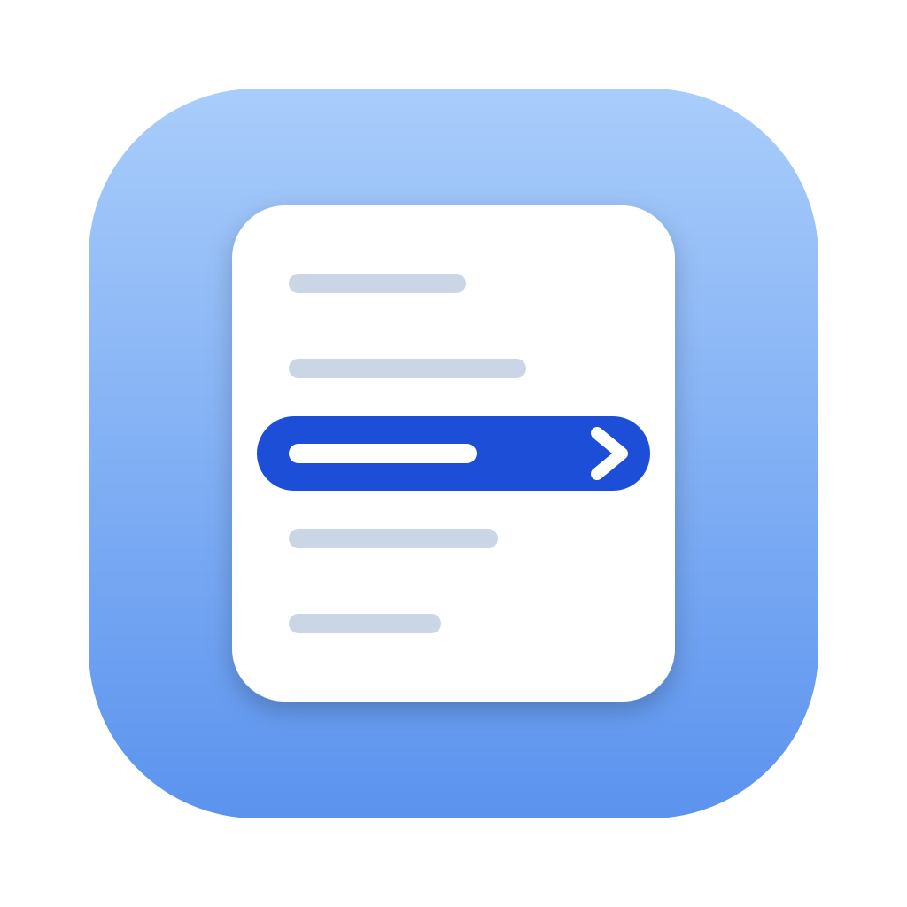

<p align="center">
  
</p>

# RightClick

Make the Finder right-click menu do more: create files from types and templates, copy names and paths, open items in Terminal or any app, and jump to your favorite folders.

English | [简体中文](README.zh-CN.md)

> **Status: early development.** There is no released build yet. You build the app from source, and it is not signed or notarized. The app name and bundle identifier are placeholders until the first release.

## Features

- **New File**: create files of common types, from Word, Excel, PowerPoint, and WPS documents to Markdown, JSON, and many programming languages. Turn types on or off, reorder them, and edit each type's default name and starting content. You can add your own types.
- **New from Template**: create files from your own templates. Select a file and choose **Add as Template…** to save it as one.
- **New Folder**: available inside **New File**.
- **Open with**: open selected items in Terminal, in the default app, or in any app you add to the **Apps** list.
- **Copy**: copy the name, the name without its extension, or the path.
- **Copy To… / Move To…**: send items to a folder you choose or to a favorite folder.
- **Favorite Folders**: keep the folders you use often and reach them from the menu.
- **Archives and hashes**: **Compress to ZIP**, **Extract Here**, **Compute Hash**, and **Compare File Hashes**.
- **Show or Hide Hidden Files**: toggle hidden files from the menu.
- **Delete Permanently**: off by default, and it works on selected items only.
- **Menu layout**: for each entry, choose whether it sits in the **Main Menu** or inside the **RightClick** submenu. Drag to reorder, and double-click to rename.
- **Every folder**: the menu appears in every folder. macOS asks for permission the first time an action reads Desktop, Documents, or Downloads.
- **Languages**: English, Simplified Chinese and Traditional Chinese. The Finder menu follows the same language setting.

## Requirements

- An Apple silicon Mac running macOS 15.0 or later
- Go, as set in `go.mod`. If your Go is older, the `go` command downloads the matching toolchain automatically.
- Xcode or the Xcode Command Line Tools, for `swiftc` and `codesign`

## Install

Builds are not signed with an Apple Developer ID or notarized, so macOS blocks the first launch. To open RightClick:

1. Download `RightClick.app` from the GitHub Releases page and move it to `/Applications`.
2. Double-click RightClick. macOS shows a warning. Click **Done**.
3. Open **System Settings › Privacy & Security**, scroll to the **Security** section, and click **Open Anyway** next to the message about RightClick. Enter your password or use Touch ID.
4. Click **Open Anyway** in the confirmation dialog.

The **Open Anyway** button appears for about an hour after the first attempt. If you don't see it, double-click RightClick again. Then follow [Setup](#setup) to turn on the Finder extension.

## Build from Source

Clone this repository, then run:

```sh
go tool mygo build -skip-dmg
sh extension/build.sh build/darwin-arm64/RightClick.app
open build/darwin-arm64/RightClick.app
```

The first command builds the app. The second builds the Finder Sync extension and installs it into the app bundle.

## Setup

1. Open RightClick. Its main window controls the Finder menu.
2. Turn on the Finder extension. The app shows you where to find it: open RightClick in the Extensions list in System Settings.
3. The first time an action reads a file in Desktop, Documents, or Downloads, macOS asks whether RightClick may access it. Allow it there. If you refused, allow RightClick later under **Privacy & Security › Files and Folders**.

## Settings

Settings are saved to `~/Library/Application Support/RightClick/config.json`.

Removing an entry from a list only removes it from RightClick. It never deletes a file or folder on disk.

## Privacy and Safety

- RightClick makes no network request on its own. The only one is the update check: it runs when you click **Check** in the General pane, reads the newest release from GitHub, and never downloads or installs anything.
- Actions run through a script that starts RightClick's program with `--action`. Clicking a menu item does not open the app window.
- Delete Permanently is off by default and works only on selected items.

## Development

Run the Go tests and checks:

```sh
go test ./...
CGO_ENABLED=0 go test ./...
go vet ./...
go tool mygo vet .
```

Run the Finder extension tests:

```sh
swiftc -application-extension -o /tmp/rc_ext_test \
  extension/RightClickFinderSync/FinderSyncExtension.swift \
  extension/RightClickFinderSync/MenuConfig.swift \
  extension/RightClickFinderSync/Localized.swift \
  extension/RightClickFinderSync/ActionIcons.swift \
  extension/tests/main.swift
/tmp/rc_ext_test
```

Run the app in development mode, with hot reload:

```sh
go tool mygo dev
```

After you rebuild the Finder extension, open the app again. It registers the extension at every start. If the menu does not appear, click Turn On in the Finder Extension pane, or restart Finder.

The blank Office templates are embedded in the app. To regenerate them, you need [uv](https://docs.astral.sh/uv/):

```sh
uv run --with python-docx==1.2.0 --with openpyxl==3.1.5 --with python-pptx==1.0.2 python scripts/document_templates.py
```

### Project Layout

- `cmd/rightclick/`: app start-up
- `internal/app/`: the action behind each Finder menu item, the `rightclick://` link handling, and the background run that `--action` starts
- `internal/settings/`: the settings window, built with mygo
- `internal/config/`: saved settings and their defaults
- `internal/files/`: file operations
- `extension/`: the Finder Sync extension, written in Swift. It runs each action through the `rightclick-action` script that the app installs.
- `internal/locales/`: English, Simplified Chinese and Traditional Chinese text

## Contributing

Issues and pull requests are welcome. Before you open a pull request, run the Go and Swift tests above, and keep each change focused on one thing.

## License

No license has been chosen yet. A license file will be added before the project is published.

## Acknowledgements

- [mygo](https://github.com/egoist/mygo) (MIT), the native UI framework
- [Lucide](https://lucide.dev) (ISC), the action icons
- [vscode-icons](https://github.com/vscode-icons/vscode-icons) (MIT) and [Markdown Mark](https://github.com/dcurtis/markdown-mark) (public domain), the file type icons
