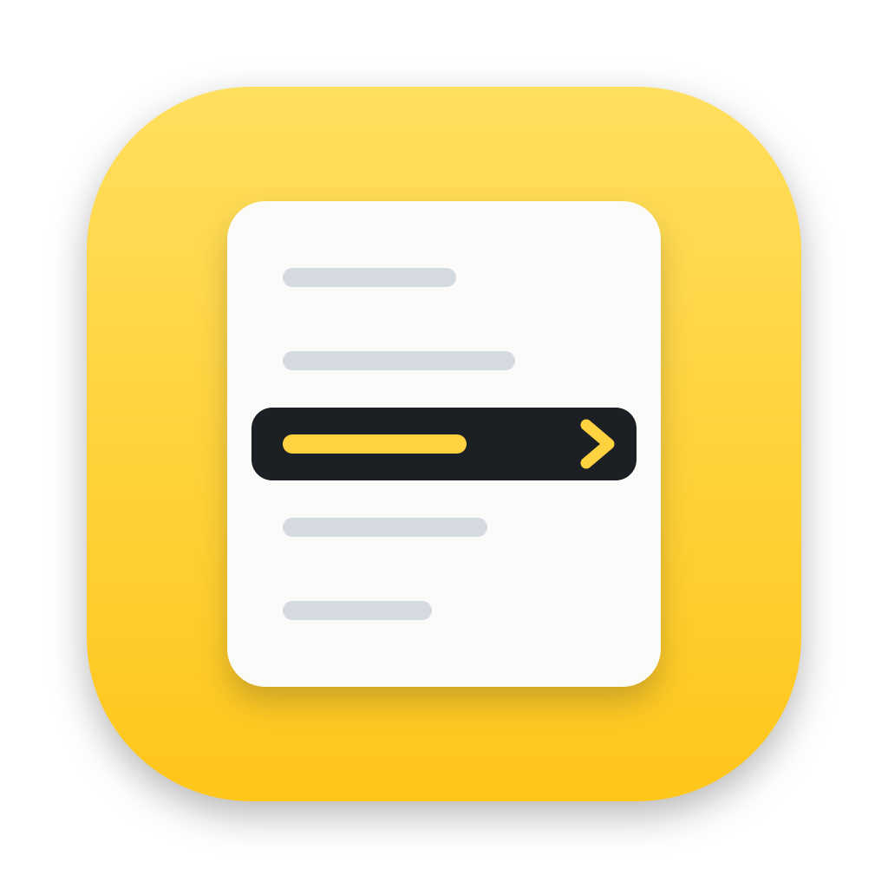

<p align="center">
  
</p>

# 右键助手（RightClick）

让访达的右键菜单更好用：按类型和模板新建文件，拷贝文件名和路径，用终端或任意应用打开，快速进入常用文件夹。

[English](README.md) | 简体中文

> **状态：开发中。** 目前还没有正式发布的版本，需要从源码构建，构建出的应用没有签名和公证。应用名称和 Bundle ID 在正式发布前都是占位值。

## 功能

- **新建文件**：按类型新建文件，从 Word、Excel、PowerPoint 和 WPS 文档，到 Markdown、JSON 以及多种编程语言。可以启用或停用类型、调整顺序，并修改每种类型的默认文件名和初始内容。也可以添加自己的类型。
- **从模板新建**：用你自己的模板新建文件。选中一个文件后点「添加为模板…」，即可保存为模板。
- **新建文件夹**：位于「新建文件」里面。
- **用 X 打开**：用终端、默认应用，或「应用」列表里添加的任意应用打开选中的项目。
- **拷贝**：拷贝文件名、拷贝文件名（不含扩展名）或路径。
- **复制到… / 移动到…**：把项目复制或移动到你选择的文件夹，或常用文件夹。
- **常用文件夹**：收藏常用的文件夹，从菜单直接进入。
- **压缩与哈希**：压缩为 ZIP、解压到此处、计算哈希、比较两个文件的哈希。
- **显示/隐藏隐藏文件**：在菜单里切换。
- **彻底删除**：默认关闭，且只作用于选中的项目。
- **菜单位置**：每一项可以选择放在**主菜单**，还是放在**右键助手**子菜单里。可以拖动排序，双击改名。
- **所有文件夹**：菜单在任何文件夹里都会出现。动作第一次读取「桌面」「文稿」「下载」里的文件时，macOS 会询问是否允许。
- **语言**：简体中文、繁体中文和英文。访达菜单跟随同一个语言设置。

## 系统要求

- 搭载 Apple 芯片或 Intel 芯片的 Mac，macOS 15.0 或更高版本
- Go，版本见 `go.mod`。本机的 Go 较旧时，`go` 命令会自动下载匹配的工具链。
- Xcode 或 Xcode 命令行工具（提供 `swiftc` 和 `codesign`）

## 安装

发布版没有使用 Apple 开发者证书签名，也没有公证，所以 macOS 会阻止第一次打开。打开方法：

1. 从 GitHub Releases 页面下载你的 Mac 对应的磁盘映像：Apple 芯片用 `RightClick-0.1.0-arm64.dmg`，Intel 芯片用 `RightClick-0.1.0-x86_64.dmg`。（「关于本机」里，Apple 芯片显示「芯片」，Intel 显示「处理器」。）打开映像，把 RightClick 拖到「应用程序」文件夹。
2. 双击 RightClick，macOS 会弹出警告，点「完成」。
3. 打开「系统设置 › 隐私与安全性」，滚动到「安全性」区域，点 RightClick 那条提示旁边的「仍要打开」，输入密码或使用触控 ID。
4. 在弹出的确认框里再点一次「仍要打开」。

「仍要打开」按钮只在第一次尝试后约一小时内出现。如果没看到，就再双击一次 RightClick。之后按[设置](#设置)一节开启访达扩展。

## 从源码构建

克隆本仓库，然后运行：

```sh
go tool mygo build -skip-dmg
sh extension/build.sh build/darwin-arm64/RightClick.app
open build/darwin-arm64/RightClick.app
```

第一条命令构建应用。第二条命令构建访达扩展，并把它安装进应用包。

## 设置

1. 打开右键助手。主窗口用来配置访达菜单。
2. 开启访达扩展：应用会告诉你在哪里开启，即在「系统设置」的「扩展」列表中打开右键助手。
3. 第一次有动作读取「桌面」「文稿」或「下载」里的文件时，macOS 会询问是否允许右键助手访问。在弹窗里点允许即可；如果拒绝了，之后可以到「系统设置 › 隐私与安全性 › 文件与文件夹」中允许右键助手。

## 保存位置

设置保存在 `~/Library/Application Support/RightClick/config.json`。

从列表中删除一项，只是把它从右键助手里移除，不会删除磁盘上的任何文件或文件夹。

## 隐私与安全

- 右键助手自己不发起任何网络请求。「检查更新」（应用菜单或设置里的按钮）会在浏览器中打开 GitHub 上的最新版本页面，下载和安装由你自己完成。
- 动作通过一个脚本运行，脚本以 `--action` 参数启动右键助手的程序，点击菜单项时不会打开应用窗口。
- 彻底删除默认关闭，且只作用于选中的项目。

## 开发

运行 Go 测试和检查：

```sh
go test ./...
CGO_ENABLED=0 go test ./...
go vet ./...
go tool mygo vet .
```

运行访达扩展的测试：

```sh
swiftc -application-extension -o /tmp/rc_ext_test \
  extension/RightClickFinderSync/FinderSyncExtension.swift \
  extension/RightClickFinderSync/MenuConfig.swift \
  extension/RightClickFinderSync/Localized.swift \
  extension/RightClickFinderSync/ActionIcons.swift \
  extension/tests/main.swift
/tmp/rc_ext_test
```

以开发模式运行应用，支持热重载：

```sh
go tool mygo dev
```

重新构建访达扩展后，再打开右键助手即可。应用每次启动都会注册扩展。菜单没有出现时，在「访达扩展」页点「去启用」，或重新启动访达。

办公文档的空白模板已嵌入应用。要重新生成，需要先安装 [uv](https://docs.astral.sh/uv/)：

```sh
uv run --with python-docx==1.2.0 --with openpyxl==3.1.5 --with python-pptx==1.0.2 python scripts/document_templates.py
```

### 项目结构

- `cmd/rightclick/`：应用启动
- `internal/app/`：每个访达菜单项对应的操作、`rightclick://` 链接的处理，以及 `--action` 启动的后台执行
- `internal/settings/`：设置窗口，基于 mygo 构建
- `internal/config/`：已保存的设置及其默认值
- `internal/files/`：文件操作
- `extension/`：访达扩展，用 Swift 编写，通过应用安装的 `rightclick-action` 脚本执行每个动作
- `internal/locales/`：英文、简体中文和繁体中文文案

## 参与贡献

欢迎提交 Issue 和 Pull Request。提交 Pull Request 前，请先运行上面的 Go 和 Swift 测试，并保证每次改动只做一件事。

## 许可证

右键助手以 [MIT 许可证](LICENSE) 发布。内置的 Lucide 图标采用 ISC 许可证，见 `THIRD_PARTY_LICENSES.txt`。

## 致谢

- [mygo](https://github.com/egoist/mygo)（MIT），原生界面框架
- [Lucide](https://lucide.dev)（ISC），操作图标
- [vscode-icons](https://github.com/vscode-icons/vscode-icons)（MIT）和 [Markdown Mark](https://github.com/dcurtis/markdown-mark)（公有领域），文件类型图标
